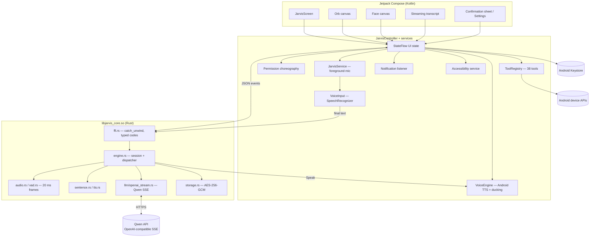
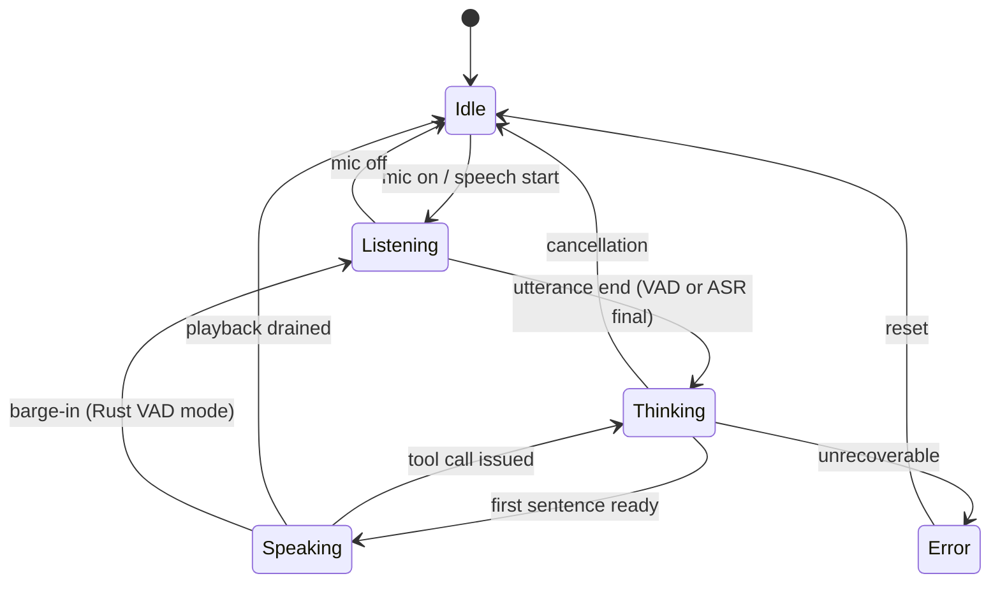
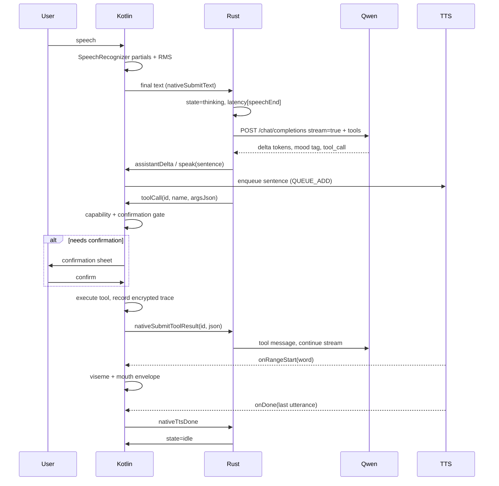

# Architecture

## Layers

## Why the split

Kotlin is the only place allowed to touch Android: permissions, services,
telephony, media, accessibility. Rust owns the realtime path and all orchestration.
The boundary is a single JSON event stream and six JNI calls, not an object graph.

The native engine never blocks on a permission dialog. A tool call becomes an
event; Kotlin checks the capability and either executes, asks for permission, or
returns a failure to Rust, which feeds it back to Qwen as the tool result.

## Threads

| Thread | Owner | Work | Rules |
|---|---|---|---|
| UI | main | Compose, `StateFlow` collection | never blocks; draws from snapshot state |
| Capture | `AudioRecord` loop (service) | 20 ms float frames → `pushPcm` | no allocation, no locks |
| DSP | `jarvis-audio` (Rust) | frame assembly, RMS, VAD, viseme, amplitude events | allocation-free per frame; SPSC consumer |
| Dispatcher | Tokio worker | session transitions, ASR, LLM turn, sentence emission | single owner of session state |
| LLM pump | Tokio worker | SSE parsing, tool-call assembly | cancellable at every `next()` |
| TTS callback | main / binder | word ranges → visemes, `ttsDone` | posts to flows |

The capture → DSP hand-off is a wait-free SPSC ring (`rtrb`). The producer never
locks and never allocates: it pushes `f32` samples into a pre-sized ring, and a
`FrameAssembler` turns them into 320-sample (20 ms at 16 kHz) frames. If the ring
overflows, the oldest samples are dropped and the event stream reports the drop
rather than blocking the audio thread.

## Session machine

Transitions are centralized in `core/src/session.rs` and unit-tested; illegal
transitions are ignored and logged instead of panicking. The UI mirrors the state
it is told about — it never derives its own.

## One turn, end to end

Tool round-trips reuse the same HTTP conversation: the assistant message with
`tool_calls` and the `tool` result are appended to history, then the stream
resumes. Tool results are truncated to keep the context bounded, and each turn
allows at most three tool calls (the brief's cap) to prevent loops.

## Event contract

`EngineEvent` is serialized as a `type`-tagged JSON object
(`core/src/events.rs`). Kotlin maps it to a sealed class. The important ones:

| Event | Meaning | UI use |
|---|---|---|
| `state` | idle/listening/thinking/speaking/error | orb mode, control labels |
| `micAmplitude` | real 16 kHz RMS, ~50 Hz | radial waveform |
| `ttsAmplitude` | playback RMS, ~60 Hz | orb pulse and face mouth |
| `partialTranscript` / `transcript` | ASR hypothesis / final | ghost line, user bubble |
| `assistantDelta` | streamed token | typing effect, no buffering |
| `speak` | sentence + question flag + index | TTS queue order |
| `mood` | parsed mood tag | face expression |
| `toolCall` | id, name, arguments | registry + confirmation |
| `toolTrace` | tool, args, result, ok, ms | diagnostics, encrypted log |
| `bargeIn` | user spoke over JARVIS | stop TTS immediately |
| `latency` | stage + ms | diagnostics, LATENCY.md |
| `error` | typed `JarvisError` | red orb + retry action |

Amplitudes are measurements, never oscillators: the UI must not synthesize
motion when a real value exists, and falls back to a static state ring when
animations are disabled.

## Storage

* `SecureStore` holds the Qwen key and the transcript data key. Both are
  AES-256-GCM encrypted with a non-exportable Keystore key.
* Rust receives the data key as base64 at engine creation and appends
  length-prefixed AES-GCM records to `files/jarvis/transcript.enc`. A record's
  associated data binds its index, so reordering is detected.
* Tool traces are persisted through `nativeRecordToolTrace`, encrypted with the
  same key and capped in the UI at 80 entries.
* Nothing is written to external storage; `allowBackup=false` and the data
  extraction rules exclude everything.

## Failure containment

* Every JNI entry point catches panics; the panic becomes an error code and a
  Kotlin exception, never a native crash.
* Unknown tool names and malformed JSON arguments return a structured failure to
  Qwen, which can correct itself.
* A missing capability returns `missingPermission` and the tool result says so;
  the UI offers the exact grant.
* Network failure mid-stream preserves the text already spoken and emits a typed
  error; the next turn starts from a clean session.
* The LLM request has a connect/read timeout and a cancellation token; STOP
  aborts the HTTP body read rather than detaching a thread.

## Build pipeline

`preBuild` → `cargo ndk … build --release` → `jniLibs/<abi>/libjarvis_core.so` →
AGP packages them. R8 keeps the `@Keep` JNI surface. The debug variant is not
minified, so the native symbols resolve during development; release rules
preserve the class and native method names.
