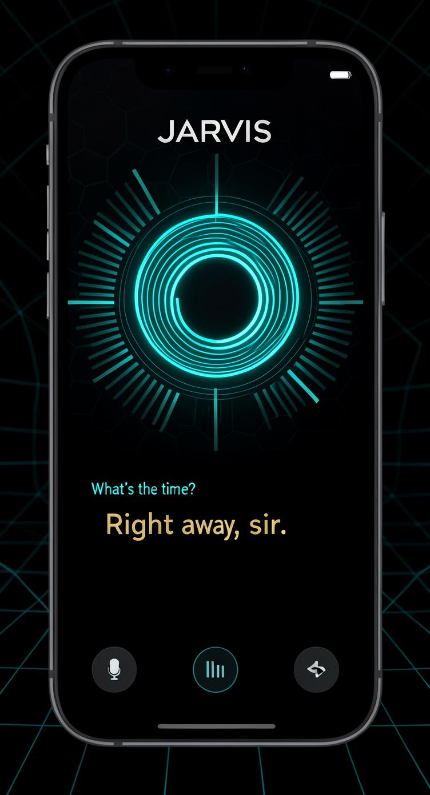

# JARVIS

An offline-first voice assistant for Android: Rust engine, OpenAI-compatible
remote reasoning, device tools, and an arc-reactor UI that reacts to real audio.



## Download

**[Download JARVIS v0.2.1 — debug APK (32 MB)](https://github.com/itsupportgoc-alt/jarvis-android/releases/download/v0.2.1/jarvis-0.2.1-debug.apk)**

Includes arm64-v8a, armeabi-v7a and x86_64 native libraries; requires Android 10+
(API 29). The APK is debug-signed for testing: enable "install unknown apps"
for your browser or file manager, then open the file. It is **not** Play Store
ready (restricted SMS/call-log/accessibility permissions; see the policy notes
below).

> The image above is a design mockup of the interface, not a screenshot from a
> device.

```
android/   Kotlin + Jetpack Compose app
core/      Rust engine compiled to libjarvis_core.so
models/    model download scripts and local model storage (not committed)
```

## Status at a glance

Honesty first — this is a complete source tree, not a store-ready product. What
is built, and what was verified on the authoring machine:

| Piece | State | Verified here |
|---|---|---|
| Rust control plane (session machine, sentence chunker, SSE parser, tool-call assembly, mood tags, VAD, ring buffer, encrypted store, encrypted memory, viseme DSP) | Implemented | `cargo test` (94 tests), `cargo clippy -D warnings`, `cargo bench`; cross-compiled to all 3 ABIs |
| Remote reasoning (OpenAI-compatible SSE, model fallback, cancellation) | Implemented | Parser + request tests; no live API call |
| Local memory + keyless start (AES-256-GCM journal, approval policy, Settings review/export) | Implemented | Rust + JVM tests; no device run |
| JNI boundary (`catch_unwind`, typed codes, lock-free PCM push) | Implemented | Compiles on host; only runs in a JVM |
| Kotlin device layer (~38 tools), Keystore, permissions, services | Implemented | `ktlint` clean; 41 JVM tests |
| Compose UI: orb, character face, transcript, confirmation, undo, settings, diagnostics | Implemented | `./gradlew assembleDebug` **BUILD SUCCESSFUL** — 37.6 MB debug APK with arm64/armv7/x86_64 `.so` |
| Voice input | Android `SpeechRecognizer` (offline-preferred) ships and works; Rust Whisper path is feature-gated | Not run on a device here |
| Android TTS | Implemented, sentence-streamed, ducking, real word timings for visemes | Not run on a device here |
| **Wake word** | **Not compiled.** Interface + openWakeWord pipeline documented; model download provided | — |
| **Local Qwen (GGUF)** | **Backend compiled; not wired into the engine or UI.** `QwenLocal` behind `local-llm` | Cross-compiled for arm64/armv7/x86_64; no model loaded or inference run |
| **Piper / sherpa-onnx TTS** | **Not compiled.** `TtsEngine` seam + Piper model download only | — |
| Device latency budget (wake/ASR/TTS/end-to-end) | Instrumented, not measured on hardware | — |

If you need a working "speak → answer → speak" demo today, it works through the
system recogniser and system TTS with a relay or DashScope key. The Rust Whisper build is the
route to a guaranteed-offline ASR; see below.

## What it feels like

One full-screen surface, no app bar.

* **Orb** — concentric arcs, 8 s/revolution at idle, 2 s while thinking, real
  mic RMS blooming outward as radial bars while listening, gold pulse driven by
  TTS word envelopes while speaking, red flicker on fault. Drawn with Canvas;
  geometry and colours are remembered, so the draw path allocates nothing.
* **Character face** — optional: layered vector head, brows/eyes/pupils/mouth,
  random blinks every 3–7 s, slow sway, mood-driven expression, visemes from the
  word the TTS engine is currently speaking.
* **Transcript** — slides up, user in cyan, JARVIS in gold, tokens appear while
  Qwen streams, auto-scroll pauses when you scroll up.
* **Bottom controls** — MIC/STOP (long-press force-stops), MUTE, INTERRUPT
  (kills the LLM stream and playback), TRACE/SETTINGS, plus a text field.
* **Confirmation sheet** — "JARVIS wants to call Maria. Confirm / Cancel." with
  a five-second UNDO affordance for reversible actions.
* **Animation scale** respected: with animations disabled the orb becomes a
  static state ring and the face holds still.

## Requirements

* Android 10 (API 29) minimum, target/compile API 35
* JDK 17, Gradle 8.11.1 (wrapper committed), AGP 8.7.3, Kotlin 2.0.21
* Android SDK platform 35 + build-tools 35.0.0
* NDK r26+ (`26.1.10909125` pinned), Rust 1.80+ (built with 1.99), cargo-ndk 4.1.2
* A device with a microphone; arm64-v8a recommended

## Setup and build

```bash
./setup.sh                  # targets, cargo-ndk, SDK/NDK checks, local.properties
./models/download_models.sh # optional on-device models
./android/gradlew -p android assembleDebug
```

Gradle invokes, via `preBuild`:

```bash
cargo ndk -t arm64-v8a -t armeabi-v7a -t x86_64 -o app/src/main/jniLibs build --release
```

Rust only (fast loop):

```bash
cd core
cargo test
cargo clippy --all-targets -- -D warnings
cargo bench --bench latency
```

Kotlin only, without the NDK (still needs SDK 35):

```bash
./android/gradlew -p android assembleDebug -PskipRust
```

Install:

```bash
android/.sdk/platform-tools/adb install -r android/app/build/outputs/apk/debug/app-debug.apk
```

## Configure the reasoning endpoint

Open **SETTINGS → REASONING ENGINE**, pick a provider, and paste that provider's
key. The default endpoint is the **Freebuff API**
(`https://freebuff.com/api/v1/paid`, model `deepseek-v4.1-flash`): create
and fund a key at <https://freebuff.com/account/api> and paste it in. Every
preset fills the endpoint and two model IDs, and **GET A KEY ↗** opens the
provider's console. The BlackPig relay is still available as a preset.

### Start a build already connected

The repository ships no key — a key inside a published APK is readable by
anyone who unpacks it, and it spends the owner's balance. To get a **personal**
build with the Freebuff key already sealed in, provide it at build time from one
of these (all gitignored / not in the repo):

```bash
# android/local.properties  (recommended; not committed)
freebuff.api.key=sk-…

# or
FREEBUFF_API_KEY=sk-… ./android/gradlew -p android assembleDebug
# or
./android/gradlew -p android assembleDebug -PfreebuffApiKey=sk-…
```

On first launch that key is encrypted into the Android Keystore and the app
starts configured — no paste, no setup screen. Builds released here carry no key
and open on the same preset, asking for one.

Free tiers (`FREE TIER` row):

| Preset | Base URL | Default model |
|---|---|---|
| Groq | `https://api.groq.com/openai/v1` | `llama-3.3-70b-versatile` |
| Cerebras | `https://api.cerebras.ai/v1` | `llama-3.3-70b` |
| Gemini | `https://generativelanguage.googleapis.com/v1beta/openai/` | `gemini-2.0-flash` |
| Mistral | `https://api.mistral.ai/v1` | `mistral-small-latest` |
| GitHub Models | `https://models.github.ai/inference` | `openai/gpt-4o-mini` |
| NVIDIA NIM | `https://integrate.api.nvidia.com/v1` | `meta/llama-3.1-70b-instruct` |
| SiliconFlow | `https://api.siliconflow.cn/v1` | `Qwen/Qwen2.5-7B-Instruct` |
| SambaNova | `https://api.sambanova.ai/v1` | `Meta-Llama-3.3-70B-Instruct` |
| Hugging Face | `https://router.huggingface.co/v1` | `meta-llama/Llama-3.1-8B-Instruct` |
| Zhipu GLM | `https://open.bigmodel.cn/api/paas/v4` | `glm-4-flash` |
| DashScope (Qwen) | `https://dashscope-intl.aliyuncs.com/compatible-mode/v1` | `qwen3-30b-a3b` |

Paid / own key (`PAID / OWN KEY` row): OpenAI, Anthropic, xAI Grok, DeepSeek,
OpenRouter, Together, Fireworks, Perplexity, Cohere, Moonshot Kimi, Novita,
Hyperbolic, DeepInfra, Nebius, Vercel AI and the BlackPig relay. Exact base
URLs, defaults and console links live in `PROVIDER_PRESETS`
(`android/app/src/main/java/ai/jarvis/data/SettingsStore.kt`).

All of them speak OpenAI Chat Completions — `POST {base_url}/chat/completions`
with `Authorization: Bearer <key>` — so any other compatible host works too: type
its base URL and two model IDs. Model IDs must exist for your key; check the
provider's console or `GET {base_url}/models`.

**Test before you talk to it.** `TEST CONNECTION` calls `GET {base_url}/models`
with the key in the field (or the stored one), then sends one minimal
completion, and reports the real answer:
`Key accepted. N models available.` plus tappable model chips, or the exact
failure — `HTTP 401: invalid api key`, `HTTP 403: recharge_required`, an
timeout, or a DNS error. The BlackPig relay returns
`403 recharge_required` for accounts with no completed top-up even when the key
is valid; complete any recharge under **Recharge** in the console sidebar and the
same key starts working without re-entering it.

Keys are entered on the phone and kept per provider — switching from Groq to
OpenAI and back keeps both — each encrypted with a non-exportable AES-256-GCM
key in the Android Keystore. A key is never written to plain preferences, logs
or the transcript store, and none is baked into the APK or this repository; only
the configured host receives it. `Apply & restart engine` rebuilds the native
engine with the new endpoint. If the primary model is unknown to the account,
the Rust backend retries once with the fallback **before** emitting any token.

## Permission matrix

Nothing is requested at launch. Each capability is requested the first time a
tool needs it, after a plain-English rationale.

| Capability | Tools | Android permission | Requested |
|---|---|---|---|
| Microphone | voice input, VAD | `RECORD_AUDIO` (+ `FOREGROUND_SERVICE_MICROPHONE`) | first MIC tap |
| Notifications | ongoing service notice | `POST_NOTIFICATIONS` (API 33+) | after mic grant |
| Calls | `call_contact`, `end_call`, `answer_call` | `CALL_PHONE`, `ANSWER_PHONE_CALLS` | first call tool |
| Call log | `read_call_log` | `READ_CALL_LOG` | first use |
| SMS | `send_sms`, `read_sms` | `SEND_SMS`, `READ_SMS` | first use |
| Contacts | `search_contacts`, `get_contact_number`, number resolution | `READ_CONTACTS` | first use |
| Calendar | `create_event`, `read_today_events` | `WRITE_CALENDAR`, `READ_CALENDAR` | first use |
| Apps | `open_app`, `close_app`, `list_installed_apps` | `QUERY_ALL_PACKAGES` | install-time normal |
| Brightness | `set_brightness` | `WRITE_SETTINGS` (special) | Settings deep link |
| Torch | `toggle_flashlight` | `CAMERA` | first use |
| DND | `set_dnd` | `ACCESS_NOTIFICATION_POLICY` (special) | Settings deep link |
| Notifications read | `read_notifications`, `dismiss_notification` | Notification access (special) | Settings deep link |
| Screen control | `read_screen_text`, `tap_element`, `scroll`, `close_app` | Accessibility service (special, opt-in) | Settings deep link |
| Network | Qwen, web, navigation, smart home | `INTERNET` | install-time normal |

Alarms, timers, maps, media keys, battery and network status need no runtime
permission.

### Google Play policy notes (important)

* `READ_SMS`, `SEND_SMS`, `READ_CALL_LOG` are **restricted permissions**. A Play
  listing requires the core-functionality declaration and Google's approval;
  most assistant apps are rejected. Sideload for personal use.
* `QUERY_ALL_PACKAGES` needs a declaration; prefer the `<queries>` element if you
  narrow the app list.
* Accessibility is for users who explicitly enable it. This app reads screen text
  only when a tool is called, skips password fields, caps output at 4,000 chars,
  and never sends screen text anywhere except as a tool result Qwen requested.
  Google Play restricts accessibility use for non-accessibility purposes.
* `WRITE_SETTINGS`, Notification access and DND access are special access: the
  app can only deep-link to the system screen.

## Voice pipeline (as shipped)

```
MIC tap → foreground service (microphone type)
        → Android SpeechRecognizer (EXTRA_PREFER_OFFLINE)
             partials → transcript ghost line, real onRmsChanged → orb waveform
             final    → Rust submit_text
        → Qwen SSE → token delta → sentence chunk (Rust)
        → Speak event → Android TTS queue (QUEUE_ADD), ducked focus
             UtteranceProgressListener word ranges → viseme + mouth envelope
        → tts_done → session idle
```

Barge-in: with the Rust VAD path (on-device mode), detected speech during
Speaking cancels the `CancellationToken`, emits `BargeIn`, Kotlin stops TTS on
the same frame and the session returns to Listening. With the system recogniser,
INTERRUPT (or long-press MIC) does the same.

Rust owns capture framing, VAD, wake scheduling, ASR (feature), Qwen streaming,
tool-call assembly, sentence chunking, prosody, session state and the encrypted
log. Kotlin owns permissions, services and device APIs — the Rust core never
waits on a permission dialog.

## On-device engines

### Whisper (optional, feature-gated)

```bash
cd core
cargo ndk -t arm64-v8a -t armeabi-v7a -t x86_64 \
  -o ../android/app/src/main/jniLibs build --release --features whisper
```

Then place `ggml-base.en.bin` in the app's `files/models/` and select
**VOICE INPUT → On-device (Rust)**. Without the feature the engine reports a
`notConfigured` error that names the missing build step; it never pretends to
transcribe. The partial-hypothesis strategy is documented in `core/src/asr.rs`.

### Wake word (not compiled)

The interface and model files are ready (`core/src/wake.rs`,
`models/download_models.sh`). The intended detector is openWakeWord:
`melspectrogram.onnx → embedding_model.onnx → hey_jarvis_v0.1.onnx`, running on
ONNX Runtime for Android. That runtime must be cross-compiled with the NDK,
which the authoring machine could not do. Until then, use MIC (push-to-talk) and
the foreground service's standby mode. This is the largest gap in the brief.

### Local Qwen, Piper / sherpa-onnx

`LlmBackend` and `TtsEngine` are the seams. `QwenLocal` (`llama-cpp-2 0.1.161`)
now exists behind the `local-llm` feature and its native llama.cpp dependency
has been cross-compiled for arm64-v8a, armeabi-v7a and x86_64. It is **not wired
into `EngineConfig` yet**, so `backend: local` is still rejected by the engine
and no model has been loaded on a device. See
[docs/OFFLINE_BUILD.md](docs/OFFLINE_BUILD.md) for the exact CMake/Ninja/libclang
recipe and the three-ABI proof. Piper (`sherpa-onnx`) remains not compiled.

## Testing

```bash
core:   cargo test        # 94 unit/integration tests
        cargo clippy --all-targets -- -D warnings
        cargo bench --bench latency
        # optional local-llm three-ABI proof: docs/OFFLINE_BUILD.md
android: ./android/gradlew -p android testDebugUnitTest   # 41 tests: tools, identity, self-model prompt, memory JSON
        java -jar ktlint.jar "app/src/main/java/**/*.kt"
```

Measured host numbers and the device measurement procedure are in
[LATENCY.md](LATENCY.md). Architecture: [ARCHITECTURE.md](ARCHITECTURE.md).
Tradeoffs and rejected alternatives: [DESIGN.md](DESIGN.md).
Demo script: [DEMO.md](DEMO.md).

## Security and privacy

* API key: Keystore-encrypted; never logged. It is optional: the engine starts
  keyless and reports reasoning as not configured.
* Local memory: AES-256-GCM journal with per-line AAD, app-private storage,
  user-approved permanent records, and no automatic secret capture. See
  [docs/MEMORY_SECURITY.md](docs/MEMORY_SECURITY.md).
* Transcript and tool traces: AES-256-GCM records, one per line, key wrapped by
  the Keystore; tampering fails authentication (tested).
* Tool traces are shown in Settings and capped at 80 in memory.
* Accessibility text stays in the tool result; no background scraping.
* `android:allowBackup="false"` and data-extraction rules exclude app data.
* No analytics, no telemetry, no third-party SDKs.

## Limitations worth stating plainly

* Wake word and local Piper are not in this build. Local Qwen's native backend
  compiles for all three ABIs but is not wired into the engine or UI yet.
* Device-side latency figures (wake, ASR RTF, TTS first audio, end-to-end) and
  the 60 fps/jank checks require hardware; they are instrumented but unmeasured.
* The system recogniser may use the network on some devices; the offline Whisper
  build is the remedy.
* `close_app` returns to the home screen: Android has no API to force-stop
  another app.
* The Android UI was compiled, not visually reviewed on a device by the author.
* The APK was built but not installed or launched on hardware here (no device
  attached); runtime behaviour, permissions and audio paths remain unverified.
